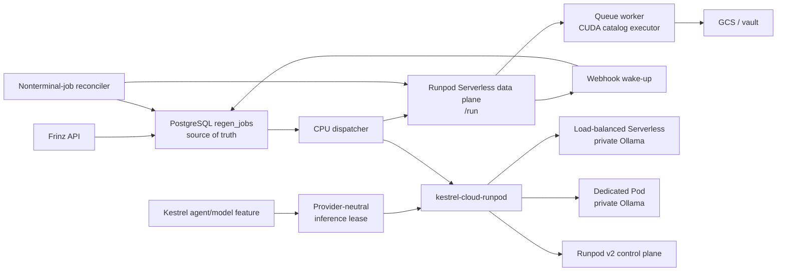
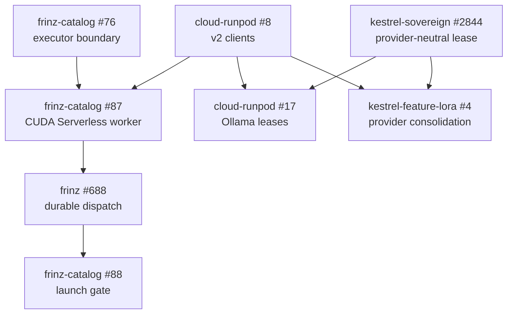

# Runpod v2 execution platform

**Status:** Accepted for staged delivery

**Date:** 2026-08-01

**Epic:** [kestrel-cloud-runpod#7](https://github.com/KestrelSovereignAI/kestrel-cloud-runpod/issues/7)

## Context

Kestrel's Runpod integration predates Runpod Serverless. It creates and manages Pods through legacy module-level Python SDK and GraphQL behavior, keeps only one active session in process memory, and relies on a TTL that is not an external billing-safety mechanism. GPU identifiers, prices, availability, and startup estimates are also embedded in local profiles.

That design was reasonable when inexpensive GPU capacity was scarce and model downloads made every replacement Pod expensive. Persistent disks and stopped Pods reduced repeat downloads, but tied the workload to a host or data-center capacity pool. Runpod provides a v2 REST control plane, queue and load-balancing Serverless endpoints, a live compute catalog, model caching, and billing records. These capabilities change the correct boundary: Kestrel should dispatch work to reusable execution services and manage durable leases, not recreate the old Pod lifecycle around a newer SDK.

This record defines one vendor boundary for three workload families:

1. Frinz catalog selfie/image inference, dispatched asynchronously to queue-based Serverless workers while PostgreSQL remains authoritative.
2. LoRA training, executed locally or on CUDA through the shared catalog contract; persistent/reused training Pods have durable ownership and external cleanup.
3. Private Ollama inference, leased through load-balanced Serverless for bursty interactive sessions or a dedicated Pod for sustained sessions.

## Decision

`kestrel-cloud-runpod` owns the typed, v2-only Runpod integration. As of the
2026-10-17 review, REST v2 is generally available; REST v1 retires on
2026-11-15 and GraphQL retires in January 2027. Production code uses neither
legacy surface nor private helpers from the Runpod Python CLI. The OpenAPI
pin, drift gate, and injectable base URL make contract changes explicit.

Runpod exposes two separate v2 services, and the distinction is part of the contract:

| Service | Canonical base URL | Responsibility |
| --- | --- | --- |
| Control plane | `https://api.runpod.io/v2` | GPU/CPU/data-center catalog, Pods, Serverless endpoint definitions and workers, volumes, registries, and billing |
| Serverless data plane | `https://api.runpod.ai/v2` | Queue job `/run`, `/status`, `/cancel`, `/retry`, and `/health` operations; endpoint-specific load-balanced traffic |

The control-plane base matches Runpod's [migration guide](https://docs.runpod.io/api-reference-v2/migrate-from-v1)
and [API-served OpenAPI document](https://api.runpod.io/v2/openapi.yaml).
This supersedes the original August beta-host discrepancy. Both base URLs
are declared once, are injectable for tests, and remain explicitly pinned to v2.

The Python `runpod` package may still be used inside a worker container for `runpod.serverless.start`. It will not be used as the infrastructure control-plane client.

## System boundaries



The Frinz catalog queue and the Kestrel inference-lease store are independent durability boundaries. They share the typed Runpod clients and placement policy, not a combined state machine.

## Canonical package contracts

Implementation under [#8](https://github.com/KestrelSovereignAI/kestrel-cloud-runpod/issues/8) will replace the legacy provider rather than add a parallel client.

### Typed transport

The package will expose two authenticated clients behind provider-neutral services:

- `RunpodControlPlaneClient` for catalog, Pod lifecycle, Serverless endpoint lifecycle, workers/logs, and billing.
- `RunpodServerlessClient` for queue job lifecycle and endpoint health. Load-balanced callers use the URLs returned by the control plane rather than reconstructing vendor URLs in consumer repositories.

The transport must:

- use bearer authentication without module-global credentials;
- use explicit connect and read timeouts;
- parse `application/problem+json` responses into typed errors;
- respect `Retry-After`, `RateLimit`, and `RateLimit-Policy` headers;
- retry only operations known to be safe and idempotent;
- preserve enough request/resource context for actionable logs without recording credentials, prompts, or signed artifact URLs; and
- expose a test transport so the full success and failure contract is exercised without provisioning live resources.

Create requests are not automatically retried after an ambiguous timeout or connection failure. The caller first persists an attempt identity and desired-resource fingerprint. An ambiguous result enters `reconcile_required`; the reconciler searches for the accepted resource and records its provider ID before any replacement request is authorized. This rule prevents a network timeout from creating unbounded duplicate Pods or endpoints.

### OpenAPI pin and drift detection

The API contract is an external dependency with an explicit upgrade process:

1. Vendor the reviewed [v2 OpenAPI YAML](https://api.runpod.io/v2/openapi.yaml) with its source URL, retrieval date, and SHA-256 checksum.
2. Generate or validate typed request/response models deterministically from that pinned document.
3. Commit generated artifacts only when they are required at runtime; otherwise make CI prove regeneration produces no diff.
4. Add contract tests for every operation the package uses, including list envelopes, nullable fields, action schemas, and RFC 9457 errors.
5. Add a scheduled/manual drift check that fetches the live schema, reports the semantic diff, and opens or fails with an actionable update requirement. It must not silently overwrite the pin.
6. Keep authenticated smoke tests opt-in and read-only by default. Mutating smoke tests require an explicit disposable-resource fixture and guaranteed teardown.

An additive upstream field does not require an emergency release. A removed/renamed field, enum narrowing, required-field change, path change, or security change blocks a client upgrade until reviewed. The API-served OpenAPI document is authoritative for wire shapes.

## Catalog, placement, pricing, and billing

Placement begins with the live v2 catalog, not a configured SKU name or hourly price. A request describes constraints such as:

- product (`SERVERLESS` or `POD`), GPU count, minimum VRAM, and minimum CUDA version;
- Secure or Community Cloud policy and allowed data centers;
- permitted GPU pools or hardware families;
- maximum estimated hourly rate and maximum authorized total cost; and
- workload benchmark identity, such as `catalog-pulid` or `ollama-interactive`.

The client queries `/catalog/gpus` with the availability expansion and product context. Placement first rejects candidates that violate hard privacy, region, CUDA, memory, or budget requirements. It then ranks remaining candidates by availability, measured workload performance, and effective cost. Every decision records the catalog timestamp, selected pool/type, offered rate, constraints, and benchmark version so it can be explained later.

Marketing SKU names are useful benchmark labels, not durable API identifiers. The initial benchmark matrix includes PRO 6000 MIG 1g.24gb, PRO 6000 MIG 2g.48gb, RTX PRO 4500, and RTX PRO 4000 Blackwell, but production configuration will use identifiers/pools returned by v2 and validated by the pinned schema.

The beta catalog observed on 2026-08-02 returned `pool=null` for both PRO
6000 MIG Serverless products. On 2026-10-17, the GA catalog instead returned
`AMPERE_24` (1g.24gb) and `ADA_48_PRO` (2g.48gb), but each pool includes other
GPU types. A canonical pool is now available, not an exact MIG placement
guarantee. All Serverless placement, including private Ollama, rejects ambiguous pools before creation;
they cannot promise an exact GPU/rate/benchmark identity from one member of
a shared pool. Missing IDs also fail clearly and are never derived from a
SKU name. [Issue #21](https://github.com/KestrelSovereignAI/kestrel-cloud-runpod/issues/21)
tracks the remaining placement-contract gap. An explicitly quoted Pod or
an unambiguous Serverless pool remains a separate product choice.

Estimates use the live placement rate. Actual spend is reconciled from `/billing/serverless` or `/billing/pods` and attributed back to the catalog job or inference lease. A price change therefore affects a new placement decision without requiring a code release, while existing decisions remain auditable.

Finite queue jobs use the versioned `ServerlessCapacityQuote` contract rather
than the dedicated-Pod quote. The host supplies only a workload kind and the
SHA-256 of its normalized inference parameters plus an operator-defined endpoint
profile and benchmark. Quoting reads the Serverless catalog and reusable endpoint
definition; it cannot create, update, delete, submit, cancel, or retry anything.
The selected pool must resolve to one exact GPU, the endpoint must constrain
workers to that single pool and one data center, and its immutable worker,
autoscaling, timeout, disk, and idle-tail settings must match the profile. A
second read-only observation immediately before dispatch rejects stale quotes or
upward price and placement drift. The quote also binds the exact `/run` policy:
execution timeout must be between 5 seconds and 7 days, while queue TTL must be
between 10 seconds and 7 days. Because initialization is a distinct billable
phase in this contract, the TTL must cover maximum queue delay, worker startup,
and execution rather than treating startup as free or outside job lifespan.

Runpod documents that Serverless workers are billed from startup through
execution and the configured idle tail. The data plane's job-level `delayTime`
combines queue wait and worker cold start, so the receipt names it
`pre_execution_delay_ms` and validates it against both accepted bounds; only
execution is separately observed. The v2 billing route is
coarser: it emits endpoint-level hourly buckets. Kestrel never derives a fictive
job cost from execution time. An authoritative `ServerlessBillingReceipt` is
available only when the exact terminal job/attempt is bound to a caller-owned
exclusive endpoint-window proof that allocates every touched UTC hour and every
closed billing bucket is complete and internally consistent. Billable coverage
ends at completion plus the accepted endpoint idle tail, not at job completion;
the host's canonical allocation may conservatively include earlier/later hours
reserved through quote expiry and worst-case execution. Cloud requires that
ordered contiguous allocation to cover the exact job interval, queries every
reserved hour, and waits for the final allocated hour to close. The receipt
binds the exact coverage end and accepted tail while startup and observed
idle-tail measurements remain null because v2 does not return them per job. This makes the current throughput tradeoff explicit:
Frinz must serialize accepted attempts by endpoint billing window or provision a
separately attributable endpoint until Runpod exposes finer billing identity.
An ambiguous `/run` acceptance has no provider job ID to query. The host still
retains its exact worst-case exclusive endpoint/hour allocation, accepted quote,
and cost ceiling. Cloud's `final_ambiguous_window_billing()` waits for all of
those hours to close and maps strict REST-v2 endpoint aggregates to a typed
receipt with actual cost, consumer-capped cost, and operator loss. An empty or
partial response remains pending because v2 does not attest that billing is
final. The canonical receipt evidence is the ordered sequence of endpoint-hour
costs. Each item preserves the v2 record's UTC hour bounds, endpoint identity,
all component amounts, total, and a deterministic provider-observation ID over
the complete normalized source record; aggregate receipt amounts are validated
as sums of that sequence. Frinz can therefore map the evidence losslessly to its
provider-neutral ambiguous-window receipt and never reaches through Cloud to the
Runpod control client.

`read_exact_serverless_billing()` exposes that same endpoint-hour observation
path without catalog-only jobs, quotes or activation DTOs, for original Ollama
inference leases. It requires the original endpoint ID, creation time and
verified-absence time, waits for every touched UTC hour to close, and reads
bounded batches with the same exact record/query/component checks. Empty or
incomplete history returns pending, never an inferred zero. Catalog retired
endpoint receipts delegate to this reader; neither API grants cleanup/spend
authority or invoice finality. Each caller must keep the original evidence and
its own durable selection/correction policy before applying costs.
See Runpod's [Serverless pricing](https://docs.runpod.io/serverless/pricing) and
[job-state metrics](https://docs.runpod.io/serverless/endpoints/job-states).

## Choosing an execution mode

| Mode | Use | Backpressure and lifecycle | Cost/latency posture |
| --- | --- | --- | --- |
| Queue-based Serverless | Catalog image jobs and other finite asynchronous work | Runpod queues work and exposes job status/cancel/retry; Kestrel retains durable orchestration | Scale to zero by default; accept measured cold start in exchange for no idle Pod |
| Load-balanced Serverless | Interactive Ollama/native HTTP streaming | Direct request routing, no durable queue and no automatic backlog handling; callers retry readiness/no-worker responses safely | Scale to zero for bursty sessions, with an intentional warm idle window |
| Dedicated Pod | Sustained Ollama sessions, LoRA training when benchmark evidence favors it, and development canaries | Kestrel owns durable capacity, readiness, a hard deadline, and external stop/termination reconciliation | Prefer only when expected utilization or model-cache reuse beats measured Serverless initialization and idle tail |

Runpod documents the behavior and tradeoffs of [queue and load-balancing endpoints](https://docs.runpod.io/serverless/load-balancing/overview). Catalog execution is transport-specific: selfie and avatar inference submit to an operation-bound queue-based endpoint after its durable activation, while explicit LoRA training creates one disposable, attempt-scoped v2 Pod. Frinz persists each original endpoint or Pod identity and its cleanup authority; an owned inference endpoint and disposable training capacity are physically retired and verified absent before lifecycle settlement. Neither path treats an unowned shared endpoint as reusable job authority.

Endpoint policy is measured per workload. Initial safe defaults are minimum workers zero, a bounded maximum worker count, FlashBoot enabled, and explicit queue/idle/execution timeouts. Production values are outputs of the benchmark gate, not constants in this record.

## Catalog execution and reconciliation

PostgreSQL `regen_jobs` remains the sole source of truth for client-visible catalog job identity and state. The Runpod queue is an execution transport.

The catalog path will be split into:

1. A canonical device-neutral request/result contract and engine router.
2. The existing local MPS executor.
3. A CUDA executor packaged as a queue-based Serverless worker.
4. A cheap CPU dispatcher, idempotent webhook handler, and low-frequency reconciler in Frinz.

The dispatcher atomically claims eligible work, constructs a normalized request, and submits it using `/run`. It never holds a database transaction across the network call. Provider endpoint ID, job ID, attempt ID, dispatch timestamps, status, typed error, and telemetry are persisted before the local claim is released.

The Serverless worker processes exactly one normalized job and never polls Cloud SQL or receives database credentials. Inputs and output targets are narrowly scoped, time-limited capabilities. The worker uploads directly to GCS/vault and returns a small artifact receipt rather than generated bytes. This avoids coupling correctness to Runpod's result-retention window; Runpod documents 30-minute retention for asynchronous results in its [operation reference](https://docs.runpod.io/serverless/endpoints/operation-reference).

Runpod [webhooks](https://docs.runpod.io/serverless/endpoints/send-requests#webhook-notifications) have limited retries. No signed webhook-verification contract is currently documented, so callbacks are untrusted wake-up hints. The handler validates the endpoint/job/attempt association and re-fetches authoritative status with a restricted Serverless credential before committing terminal state. Duplicate and out-of-order callbacks are harmless.

A reconciler polls only nonterminal submitted jobs using bounded exponential cadence. It recovers webhook loss, process crashes, ambiguous submissions, and teardown failures. Cancellation propagates to `/cancel`; a late result for a cancelled or superseded attempt cannot publish an artifact.

## Model and artifact storage

Catalog inputs and outputs remain in canonical Kestrel storage. Network volumes are not the default artifact store.

For model weights, prefer in order:

1. Runpod [cached models](https://docs.runpod.io/serverless/endpoints/model-caching) when one large Hugging Face repository maps cleanly to an endpoint.
2. Reproducibly baked private/smaller weights in the worker image.
3. A network volume only when benchmark evidence justifies its operational constraints.

Runpod currently limits an endpoint to one cached model repository. A single network volume restricts execution to its data center; multiple volumes do not synchronize automatically, and concurrent writers require coordination. These [network-volume constraints](https://docs.runpod.io/storage/network-volumes) recreate part of the old capacity/zone problem, so a volume is an explicit placement constraint and cost, never an invisible cache assumption.

## Durable resource leases and cleanup

Every billable Pod and every logically reserved interactive endpoint/session must have durable ownership. In-memory TTL state is not sufficient.

A lease records at least:

- stable lease and owner/workload IDs;
- requested model/runtime and placement constraints;
- provider resource type, ID, endpoint URLs, and operation-attempt identity;
- created, readiness, last-used, idle-deadline, and hard-deadline timestamps;
- catalog snapshot/rate, maximum authorized spend, estimated spend, and reconciled actual cost;
- lifecycle state, last typed provider error, and teardown state; and
- idempotency and reconciliation metadata.

Creation, readiness, use, release, expiry, and teardown are explicit state transitions. Teardown never clears the provider ID before Runpod confirms termination. A periodic process outside the requesting agent terminates expired or orphaned Pods and keeps failures visible and retryable across restarts.

Disposable catalog Pods also retain one immutable, versioned, content-free
evidence projection on that same lease row. It binds accepted catalog identity
to realized GPU/cloud/data-center/rate, first-observed lifecycle timestamps,
strict allowlisted worker timings/resources, confirmed stop, and authoritative
billing. The projection never contains routes, credentials, private payloads,
artifact capabilities, images, signed URLs, weights, or raw mappings. Success
evidence remains incomplete until the Pod is stopped and billing covers the
full interval; migrated rows report explicit missing evidence.

Training Pod acquisition distinguishes capacity this invocation created/resumed from a Pod that was already running. The former is stopped on every readiness, route, submission, or cancellation failure; a failed stop retains the Pod ID and cleanup token for the external reconciler. The latter may be used when explicitly configured, but the invocation does not gain authority to stop shared pre-existing capacity. Hardware fallback attempts retain exact attempt tokens and share the caller's persisted root cleanup identity. Root cleanup is a durable closed-family transition: it blocks later child reservations, releases every active child, and is resumed after a crash. The SQLite migration recognizes deterministic pre-family child hashes by recomputing them for configured profile IDs because those UUID hashes cannot be inverted. Provider job ID and result-recovery state remain attached to the same durable record through LoRA publication.

Runpod notes that Pods with network volumes cannot be stopped, only terminated, and that a restarted Pod may receive zero GPUs when capacity changes. The provider therefore does not promise cheap resume as an availability strategy; it follows the current [Pod lifecycle contract](https://docs.runpod.io/pods/manage-pods).

## Private Ollama

Private Ollama is a separate workload contract from the catalog worker.

The model feature selects a model. A provider-neutral inference-lease service acquires private capacity and returns a bounded route only after readiness. `kestrel-cloud-runpod` implements that provider contract without exposing Runpod concepts in Kestrel core.

The package registers `runpod` in the SDK's dedicated inference-provider entry
point group. Capability matching is deterministic (`ollama`, authenticated
endpoint, OpenAI chat/completions/embeddings/streaming/tools, one expected
concurrent request, and explicitly configured Runpod data-center IDs). The
runtime requires the exact digest-pinned model to report Ollama `completion`
and `tools` capabilities before readiness, so the default full-agent route
never degrades to a tool-free lane. This matches Ollama's documented
[OpenAI-compatible tools support](https://docs.ollama.com/api/openai-compatibility)
and [Qwen3 tool-calling contract](https://docs.ollama.com/capabilities/tool-calling).
A quote is a
read-only v2 catalog operation. The selected mode, observed price, configured
cold-start estimate, full expected session, and Serverless idle tail must fit
the caller's hourly, total, region, privacy, and readiness limits before the
first create request.

Acquisition returns `PENDING`; later status calls drive the durable provider
state. `READY` is emitted only after an authenticated observation proves both
runtime health and the exact requested model. The OpenAI `/v1` endpoint and
workload bearer exist only in the host's SDK route object. SQLite retains the
resource identity and cost/expiry policy, never the addressable endpoint or
credential. A restarted adapter re-observes that same deterministic resource,
so it can reconstruct the route without provisioning a duplicate.

Create and teardown mutations stay joined to their original durable receipt
tail even if the caller cancels repeatedly. An ambiguous or undecodable create
response remains discoverable after every deadline; elapsed time and an empty
inventory never prove that the original create was rejected. Teardown succeeds
only after an authenticated exact-ID GET reports 404, not merely because the
delete/action request was acknowledged. A present resource, authentication
failure or unavailable read keeps teardown pending for reconciliation.

One service clock instant and one recursively immutable prepared create object
define each admitted attempt. The request owns a deep-frozen copy of every
environment, scaling, and mount value before admission, so the digest check and
threaded HTTP serialization consume the same snapshot. Before POST, SQLite
stores a content-safe canonical intent containing the exact payload digest,
environment-key set and environment-value digest; the raw environment values
remain only in that in-memory prepared request.
The aggregate also stores the original nullable `requested_at` value and exact
readiness-timeout integer used by the request fingerprint. A REQUESTED restart
reuses those inputs byte-for-byte; it never derives replacement authority from
`created_at`, a deadline, or the restart clock. Accepted per-GPU catalog rates
are scaled to whole-resource rates with context-independent Decimal/integer
arithmetic, so ambient Decimal precision cannot alter durable authority.
After POST, the provider ID is acknowledged before an exact-ID GET is used to
construct an immutable provisioning receipt. Endpoint image and environment
are optional in the v2 response schema, as are Endpoint type, disk, ports, and
an explicitly accepted registry; their omission is unavailable evidence rather
than a confirmed mismatch and can never produce `READY`. Pod mounts are
required response evidence: explicit `{}` proves mountless policy, while
omission or `null` does not. Dedicated-Pod
placement and whole-Pod rate likewise come only from a live `PROVISIONING`,
`STARTING`, or `RUNNING` readback. A live numeric zero is valid while an absent
rate is not; the receipt labels its precision as a parsed JSON number because
the transport does not retain the provider's original numeric lexeme.

The low-level v2 resource decoder therefore separates identity from sibling
evidence. A non-empty provider ID and name may be returned with immutable,
sanitized `missing`/`invalid` field evidence so the caller retains the exact
POST acknowledgment; malformed identity remains an ambiguous create result.
This partial object is not compatibility or readiness proof. The compatibility
Pod manager and generic Serverless lifecycle require valid evidence before
using raw configuration, and the Ollama provider folds every field into its one
complete provisioning assessment. Invalid status, rate, placement, policy,
environment, or request-URL data can consequently retain cleanup custody but
cannot publish a route, invoke a model, or manufacture a provisioning receipt.

A confirmed incompatible known resource is different from an incomplete
readback. Wrong identity, image, environment, placement, runtime policy, or a
live Pod rate above the accepted ceiling creates sanitized mismatch evidence
and immediately enters the same fenced exact-ID teardown path. It never waits
at a readiness deadline while known-wrong capacity accrues cost, publishes a
route, or fabricates a successful receipt. Missing fields and transient reads
remain `RECONCILE_REQUIRED` with the POST-acknowledged ID. Name-based inventory
can locate an ambiguous-create candidate only. That candidate is persisted in
a separate immutable aggregate field and survives restart, but is neither
provider ownership nor deletion authority. Only a complete exact-ID readback
that binds the original intent may atomically promote it to the owned provider
ID; incomplete or mismatching candidate evidence never authorizes DELETE.
Direct POST acknowledgement does authorize cleanup of that exact ID even when
optional readback evidence remains unavailable, but never authorizes readiness.
Confirmed fields are checked before reporting independent omissions so missing
evidence cannot hide a known policy violation on an owned resource.

The lease aggregate has one writer contract. Every insert starts at contract
version 4/epoch 1, and every update must advance both the revision CAS and the
writer epoch exactly once; SQLite triggers reject old update shapes, inserts,
and deletes. Version 4 also prevents a retained version-1, version-2, or
version-3 binary or migrator from reinstalling its weaker trigger set over a
newer aggregate. Runtime
startup never upgrades a legacy database. Operators must
first drain every old binary, admitted HTTP effect, and route holder, then call
the explicit one-shot `migrate_legacy_database()` entry point with an attestation
bound to that absolute database. The SDK requires that assertion but cannot
observe the process drain. Startup reads the live database and any outstanding
WAL inside one exclusive transaction before it performs schema or index DDL;
missing columns, wrong column definitions, non-canonical indexes, or
non-canonical triggers fail closed rather than being repaired implicitly.
The validator creates an isolated reference schema from the same table, index,
and trigger DDL builders, then compares the full table metadata, literal SQL,
implicit and explicit index origins/columns, and trigger text before touching
the target. It does not case-fold or whitespace-normalize executable SQL.
Schema addition, historical classification, route scrub, and
trigger installation occur in that same transaction, so a failed or concurrent
initializer cannot expose a partly fenced store. Existing
non-requested rows are classified `HISTORICAL_UNKNOWN` and remain cleanup-only;
saved routes are cleared in the same pre-trigger classification write, and no
migration backfills missing original fingerprint inputs or derives original
evidence from current configuration. A legacy provider ID is retained only as
an untrusted reconciliation locator, never as deletion authority. Legacy
terminal flags, a false create-uncertainty flag, or a locator 404 do not prove
original acknowledgement, physical absence, termination, or zero cost. These
rows remain route-less and visible as unknown debt. The SDK projects them as
`RELEASING`, Core's nonterminal state accepted from each live predecessor, with
original request/quote cost bounds and explicit manual-reconciliation metadata.
Provider cleanup still refuses because the retained locator is not ownership;
repeated Core status/release calls therefore cannot delete possibly foreign
capacity or describe the debt as released. Core 0.53.37 refreshes provider
evidence before returning cached terminal records and invalidates stale terminal
evidence to the provider-neutral `RELEASING` state. This keeps historical debt
visible and prevents replacement without teaching Core provider-specific
metadata. New public integer and float cost spellings are normalized once
before first acceptance, while already accepted fingerprints replay their exact
original representation. SQLite
triggers cannot retroactively fence an old process that already admitted an
HTTP effect, which is why the deployment drain is mandatory.

Version 4 also carries one durable `reconcile_after` visit time. A timer claims
a due row by revision/epoch CAS and advances that time before provider I/O, so
unchanged READY rows and retryable cleanup failures yield bounded batches to
other due cleanup and billing work across process restart. Original hard,
readiness, idle, and exact authorized-cost cutoffs remain urgent: scheduling is
never authority and cannot move those timestamps or delay their first crossed
visit. An original POST acknowledgement that arrives after a different,
completely validated discovery candidate is retained as one additional exact
cleanup target in the same lease aggregate. The route is closed and the same
cleanup owner joins both exact-ID deletions and absence receipts. Neither an
untrusted locator nor migration creates a target, and multi-resource lifecycle
billing remains visibly unknown/manual rather than selecting a partial total.

Original readiness and hard deadlines are sampled again after every awaited
planning, provisioning, readback, and readiness boundary. A late plan never
admits POST, and a late observation cannot backdate `ready_at` or publish a
route; a known owned resource instead joins the existing teardown path. An
original POST acknowledgement is attached transactionally to the latest
matching intent/attempt lineage. A concurrent release or terminalization stays
route-less and resumes only cleanup; a different name-discovery locator remains
immutable and untrusted, and cannot displace the acknowledged exact ID.

Every `OllamaCapacityProvider` implements the pure, no-I/O
`validate_runtime_request()` contract. Both quoting and the canonical lease
service call it for a concrete selected mode; the service does so before
provisioning admission, including direct manager acquisition and AUTO mode.
Invalid immutable-image/model/credential configuration therefore fails with
zero provisioning attempts and no uncertain-create debt. All errors after
admission still retain uncertain-create custody rather than infer no resource.

Before teardown I/O, the same lease aggregate freezes one cleanup intent with
the original provider ID and action-start time. Retries reuse that intent. A
cleanup receipt records the later exact-ID absence observation as an upper
bound; it does not invent the provider's exact termination instant. Provider
reads remain outside SQLite, while service-owned tasks join DELETE, absence
readback, and the receipt write under the existing effect-custody boundary.

The authenticated runtime exposes a content-free telemetry snapshot on the
same bearer-protected route. Its original intent binding is committed before
readiness. Process identity, monotonic revision, cumulative outcome counters,
and union busy duration can advance; a restart, regression, retention limit,
or final observation makes the current lineage partial. A zero-in-flight
snapshot from one process does not prove that the load-balanced worker
population and future admission are closed, so this contract reserves
`complete` for a later whole-population quiescence proof and does not emit it
for new leases. Prompts, responses, tokens, model names, and credentials are
not telemetry fields. Ordinary telemetry unavailability cannot abandon
required cleanup, and it never becomes billing evidence. A migrated historical
`complete` assertion stays immutable, while a separate telemetry-error field
can record a failed retry without blocking DELETE.

After verified absence, reconciliation reuses the canonical exact Pod or
Serverless billing reader over the original create-to-absence window. Only
closed, complete provider buckets can become an observation. The first complete
observation is selected immutably; later provider revisions are append-only
correction evidence and never replace it, debit an account, or claim provider
invoice finality. Polling, batch size, observation count, and serialized
evidence bytes are explicitly bounded. At a retention limit the existing
selection is preserved and manual reconciliation remains visible rather than
truncating history. Missing non-compute amounts keep all-in cost unknown; a raw
provider-capacity amount above the original cap is reported separately as
exceeded. Only a fresh version-3 request proven never to have reached provider
admission may record no provider effect. Migrated rows and missing original
facts remain unknown rather than gain invented rates, timestamps, termination,
zero cost, or debit authority.

Legacy `manage_gpu` commands are operator-only Pod controls. They do not mutate
or report LLM routing; the provider-neutral coordinator owns the sole active
route and drains it before provider release.

For bursty interactive sessions, the default candidate is load-balanced Serverless because Ollama's native HTTP and streaming contract requires direct routing. The endpoint must report healthy and `/api/tags` must show the requested model before Kestrel switches `LLMService` to the route. The caller handles load-balancer no-worker/initialization responses with bounded retry and never treats them as queued work. Runpod provides separate examples for [Ollama on Serverless](https://docs.runpod.io/tutorials/serverless/run-ollama-inference) and [Ollama on a Pod](https://docs.runpod.io/tutorials/pods/run-ollama).

For long or continuously active sessions, a dedicated Pod is considered using live catalog data. The decision compares expected utilization against both alternatives:

```text
maximum_cold_starts = 1 + floor(expected_session / idle_tail)
serverless_estimate = serverless_rate *
    (execution + maximum_cold_starts * (initialization + idle_tail))
pod_estimate        = pod_rate * lease_duration
```

The Serverless estimate is an invocation-independent upper bound for the
accepted session window: every complete idle interval may scale the worker to
zero and force another billable initialization. A zero idle tail has no finite
cold-start bound and is therefore ineligible for interactive Serverless. The
accepted maximum is included in SDK quote metadata and revalidated immediately
before acquisition.

Storage, model transfer, and failure/retry costs are added to both estimates. A Pod is selected only when it fits the cost cap and measured readiness target. Model pull and model-to-VRAM load are part of cold-start time and billable session cost.

Queue-based Serverless remains valid for non-streaming batch inference but is not the interactive Ollama default. If the real requirement becomes high-throughput OpenAI-compatible serving rather than Ollama compatibility, vLLM should be evaluated as a separate runtime behind the same lease contract.

## MCP boundary

Runpod's [official MCP server](https://github.com/runpod/runpod-mcp) is a valuable operator tool and a reference client for the v2 API. It is not a production dependency of the catalog dispatcher or inference-lease service.

The MCP server acts with the supplied API key's permissions. Product agents therefore do not receive unrestricted Runpod MCP/control-plane tools. They receive constrained provider-neutral operations such as acquire, status, and release for resources they own, with privacy, placement, deadline, and cost policies enforced before infrastructure changes. Operators may use MCP separately for inspection and emergency cleanup under appropriately scoped credentials.

## Security and privacy

- Use newly issued [restricted Runpod API keys](https://docs.runpod.io/get-started/api-keys) with separate control-plane and endpoint/job permissions where possible.
- Do not put a control-plane credential in a GPU worker image or catalog request.
- Store credentials in the configured secret system; never in tracked TOML, logs, telemetry, or durable job payloads.
- Authorize every lease and job status operation by stable owner/workload identity.
- Use short-lived, operation-scoped input and output capabilities. Validate destination allowlists and reject arbitrary artifact URLs to prevent SSRF or data exfiltration.
- Redact prompts, avatar references, signed URLs, model credentials, and provider response bodies that may contain them.
- Treat callbacks as untrusted until provider status is re-fetched and correlated with endpoint, job, and attempt IDs.
- Fail closed when privacy, region, GPU, readiness, or cost requirements cannot be satisfied. There is no silent switch between local and cloud execution.

## Cold-start, performance, and cost telemetry

Runpod bills Serverless workers from start until full stop, including initialization and idle tail, as described in its [Serverless pricing documentation](https://docs.runpod.io/serverless/pricing). A cheap GPU with a slow or failure-prone startup can be more expensive per successful artifact than a higher hourly-rate GPU.

Each catalog job and inference lease records:

- dispatch/provisioning duration;
- Runpod aggregate pre-execution `delayTime` (queue plus worker cold start);
- image pull, model availability/download, and model-to-RAM/VRAM load durations;
- execution and artifact upload duration;
- warm reuse and idle-tail seconds;
- peak VRAM and host RAM;
- success, timeout, OOM, cancellation, and startup-failure outcome;
- offered rate, estimated cost, and v2-billing actual cost; and
- engine/model/container/benchmark versions and selected GPU pool/type.

Runpod defines delay time as including worker cold start and exposes delay/execution fields in its [benchmarking guide](https://docs.runpod.io/serverless/development/benchmarking). Kestrel adds application-level initialization spans so queueing, image pull, and model load can be separated. Decisions use distributions—at minimum p50 and p95—not a single successful run.

Production routing is gated on measured cold and warm scenarios, two- and five-job bursts, failure/cancellation behavior, image quality versus the local MPS executor, and cost per successful job. Idle timeout and minimum-worker settings are tuned from observed inter-arrival time and latency targets. Static marketing startup claims and hardcoded profile costs are not acceptance evidence.

## Delivery plan and issue ownership

Work is staged so each repository changes only the behavior it owns:

1. [kestrel-cloud-runpod#8](https://github.com/KestrelSovereignAI/kestrel-cloud-runpod/issues/8) — typed v2-only control/data-plane clients, pinned OpenAPI contract, live placement, and billing.
2. [frinz-catalog#76](https://github.com/KestrelSovereignAI/frinz-catalog/issues/76) — extract one device-neutral executor/router while preserving the current local MPS worker.
3. [frinz-catalog#87](https://github.com/KestrelSovereignAI/frinz-catalog/issues/87) — build the CUDA executor and queue-based Serverless worker without PostgreSQL credentials.
4. [frinz#688](https://github.com/KestrelSovereignAI/frinz/issues/688) — add durable Serverless dispatch, webhook verification-by-refetch, reconciliation, cancellation, and artifact publication.
5. [frinz-catalog#88](https://github.com/KestrelSovereignAI/frinz-catalog/issues/88) — benchmark cold start, VRAM, quality, reliability, and actual cost before cutover.
6. [kestrel-sovereign#2844](https://github.com/KestrelSovereignAI/kestrel-sovereign/issues/2844) — define the provider-neutral remote inference lease and readiness-gated route integration.
7. [kestrel-cloud-runpod#17](https://github.com/KestrelSovereignAI/kestrel-cloud-runpod/issues/17) — implement that contract with durable private Ollama leases and Serverless-versus-Pod selection.
8. [kestrel-feature-lora#4](https://github.com/KestrelSovereignAI/kestrel-feature-lora/issues/4) — migrate the LoRA package's stale adapter onto the canonical v2 provider without duplicating lifecycle code.
9. [kestrel-cloud-runpod#14](https://github.com/KestrelSovereignAI/kestrel-cloud-runpod/issues/14) — persist ownership before training Pod create/resume, reconcile cleanup after crashes, and preserve provider IDs through workload failures.

Catalog LoRA training in [frinz-catalog#77](https://github.com/KestrelSovereignAI/frinz-catalog/issues/77) is launch-critical. The live gate must train real weights and consume them in a confirmed post-LoRA selfie.



The local Mac executor remains an explicit backend choice only when a live schema-3 worker capability adapter proves its readiness. Static configuration does not make it available: catalog startup currently fails closed until the local contract in [frinz-catalog#77](https://github.com/KestrelSovereignAI/frinz-catalog/issues/77) and [Frinz#827](https://github.com/KestrelSovereignAI/frinz/issues/827) is complete. Canarying or rollback may select that backend deliberately after readiness is proven; a Runpod failure never silently reroutes private work.

## Launch gates

The platform is not production-ready until all applicable gates pass:

- no production infrastructure call uses v1 or GraphQL;
- pinned-schema contract and drift tests pass;
- every billable resource is attributable and externally reclaimable after process failure;
- pre/post live-run v2 inventories account for Pods, Serverless endpoints, and
  network volumes, with no unexpected resource remaining after cleanup;
- ambiguous create, duplicate callback, webhook loss, cancellation, late completion, and teardown failure paths are tested;
- catalog artifacts publish exactly once and workers have no database credential;
- private Ollama routes activate only after the requested model is ready;
- restricted credentials and privacy/cost constraints are verified;
- cold-start p50/p95, execution p50/p95, peak VRAM, peak host RAM, success
  rate, quality, and cost are inside predeclared approved thresholds; and
- actual v2 billing reconciles with estimates closely enough to enforce budget limits.

## Consequences

Positive consequences:

- one Runpod implementation and one place to track the Runpod API;
- current availability and pricing replace stale configuration;
- scale-to-zero catalog capacity without sacrificing the existing durable job contract;
- private on-demand inference with enforceable ownership and teardown; and
- cost and cold-start behavior become measured routing inputs.

Costs and tradeoffs:

- the external control plane requires schema pinning, drift monitoring, and deliberate upgrades;
- CUDA portability is a real engine refactor, not a handler wrapper;
- webhook reconciliation and durable leases add state-machine work;
- load-balanced scale-to-zero Ollama can return temporary no-worker responses during initialization; and
- network-volume placement improves persistence but can reduce GPU availability and adds synchronization responsibilities.

These costs are accepted because reviving the old in-memory Pod manager would leave duplicate-resource, orphan-billing, stale-price, and data-center coupling risks unresolved.
